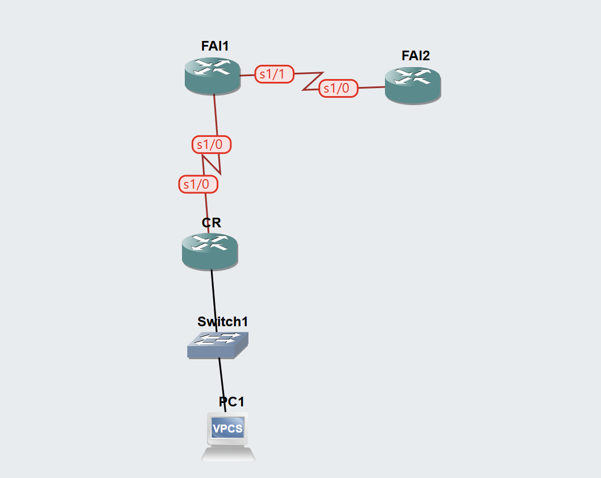

# TP BGP sur GNS3 : eBGP entre deux FAI (AS 100 et AS 200)

Travaux pratiques « Configuration d'un routeur avec le protocole BGP » (Cisco Networking Academy), réalisés sur **GNS3** avec des routeurs **Cisco c7200**.

## Objectifs

- Connecter un routeur client (CR) à son FAI (ISP1) avec une **route par défaut**.
- Configurer **eBGP** entre ISP1 (AS 100) et ISP2 (AS 200) pour échanger les routes.
- Vérifier les tables de routage et les tables BGP, puis tester la connectivité de bout en bout.

## Topologie

CR et ISP1 sont reliés par un lien série (10.10.10.0/24), ISP1 et ISP2 par un autre lien série (172.16.1.0/24). Le client (CR) n'exécute **pas** BGP.

## Plan d'adressage

| Équipement | Interface | Adresse IP | Réseau |
|---|---|---|---|
| CR | FastEthernet0/0 | 192.168.1.1/24 | LAN client |
| CR | Serial1/0 | 10.10.10.1/24 | CR ↔ ISP1 |
| ISP1 | Serial1/0 | 10.10.10.2/24 | CR ↔ ISP1 |
| ISP1 | Serial1/1 | 172.16.1.1/24 | ISP1 ↔ ISP2 |
| ISP1 | Loopback0 | 192.168.100.1/24 | réseau simulé AS 100 |
| ISP2 | Serial1/0 | 172.16.1.2/24 | ISP1 ↔ ISP2 |
| ISP2 | Loopback0 | 192.168.200.1/24 | réseau simulé AS 200 |
| PC1 | eth0 | 192.168.1.2/24 (passerelle 192.168.1.1) | LAN client |

## Environnement

| Élément | Valeur |
|---|---|
| Émulateur | GNS3 (Dynamips) |
| Routeurs | 3 × Cisco c7200 (CR, ISP1, ISP2) |
| Slot 0 | C7200-IO-FE (`FastEthernet0/0`) |
| Slot 1 | PA-8T (`Serial1/0` à `Serial1/7`) |
| PC client | VPCS |
| Optimisation | Idle-PC calculé sur l'image IOS |

### Correspondance avec le sujet

Le sujet utilise des routeurs 1841 (`s0/0/0`, `s0/0/1`). Avec le c7200 :

| Sujet | GNS3 (c7200) |
|---|---|
| `s0/0/0` | `Serial1/0` |
| `s0/0/1` | `Serial1/1` |
| `Fa0/0` | `FastEthernet0/0` |

## Contenu du dépôt

| Fichier | Description |
|---|---|
| `README.md` | Présentation du TP |
| `commandes.md` | Toutes les commandes, routeur par routeur, avec les vérifications |
| `captures/` | Captures d'écran du TP |
| `video/` | Vidéo de démonstration et sous-titres (.srt) |

## Déroulement

1. Adressage de base (CR, ISP1, ISP2, PC1) et interfaces Loopback.
2. Route par défaut sur CR, route statique de retour sur ISP1.
3. Configuration eBGP : ISP1 (AS 100) et ISP2 (AS 200).
4. Vérification des tables de routage (`show ip route`).
5. Test de bout en bout (PC1 vers 192.168.200.1).
6. Analyse des tables BGP (`show ip bgp`).

Les commandes complètes sont dans [`commandes.md`](commandes.md).

## Résultats attendus

- `show ip bgp summary` : session établie, `State/PfxRcd` numérique (1 sur ISP1, 2 sur ISP2).
- ISP2 apprend 192.168.1.0/24 et 192.168.100.0/24 par BGP (`B`, AS-Path 100).
- ISP1 apprend 192.168.200.0/24 par BGP (AS-Path 200). Le réseau 192.168.1.0/24 est une route statique injectée dans BGP avec `network`.
- CR n'a que sa route par défaut (`S*`), car il n'exécute pas BGP.
- PC1 atteint 192.168.200.1.

## Notes

- Quelques pertes de paquets sur les pings sont normales avec Dynamips, surtout sans Idle-PC. Elles viennent de la charge CPU de l'émulateur et non de la configuration.
- Le sujet original appartient à Cisco Networking Academy. Il n'est pas inclus dans ce dépôt.
